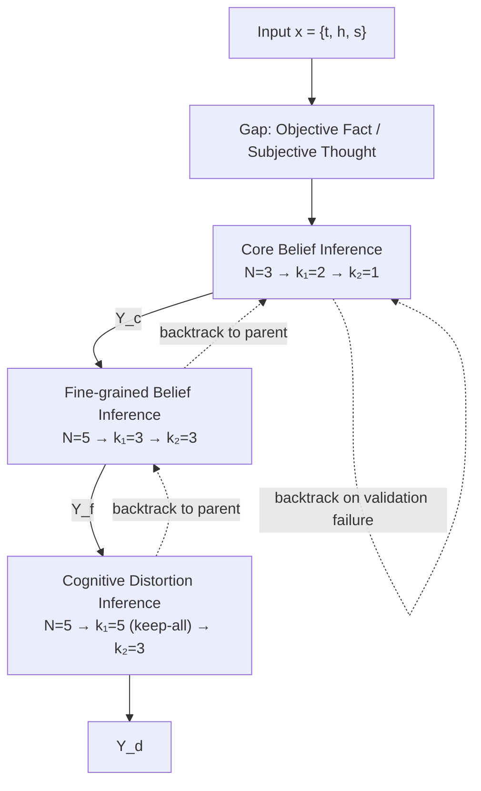

# GoTCHA

**Hierarchical Graph-of-Thoughts for Explainable Cognitive Distortion Classification**

[](https://doi.org/10.1145/3748522.3779920)
[](https://www.sigapp.org/sac/sac2026/)
[](LICENSE)

Hayeon Yang, Jihuen Hong, Jin Gyeong Park, Kyungmin Kwon, Hayoung Oh
*Proceedings of the 41st ACM/SIGAPP Symposium on Applied Computing (SAC '26)*, Thessaloniki, Greece, pp. 192–200.

---

GoTCHA implements Beck's hierarchical cognitive theory as an LLM-based graph reasoning framework. Rather than asking a model to label cognitive distortions in a single pass, it follows the clinical CBT reasoning process — core beliefs → fine-grained beliefs → cognitive distortions — where each stage conditions on the results of the one above it, mirroring how higher-level schemas shape lower-level cognitive patterns.

---

## Problem Formulation

Given an input $x = \{t, h, s\}$ consisting of the original text $t$, the thoughts $h$, and the situational context $s$, the system sequentially infers three hierarchical levels:

$$Y_c \subseteq \mathcal{C}, \quad Y_f \subseteq \mathcal{F}, \quad Y_d \subseteq \mathcal{D}$$

where $Y_c$ are the predicted core beliefs, $Y_f$ the fine-grained beliefs, and $Y_d$ the cognitive distortions. Fine-grained beliefs carry a hierarchical dependency on core beliefs, formally $\mathcal{F} = \bigcup_{c \in \mathcal{C}} \mathcal{F}_c$, so that every fine-grained category is bound to a specific core belief type.

The reasoning process is structured as a graph of operations in which three sequential subgraphs correspond to the three cognitive levels. A controller executes operations in topological order, progressively accumulating intermediate reasoning results (thoughts $\theta$) and their quality scores. Each thought is an LLM-generated hypothesis about the cognitive state at a particular level.

---

## Hierarchical Graph-Based Reasoning

Every cognitive level follows the same six-stage operation sequence, implementing iterative refinement with quality-based filtering at multiple checkpoints:

```
Generate → Score → KeepBestN⁽¹⁾ → Validate & Improve → Score_final → KeepBestN⁽²⁾
```



### Stage parameters

| Level | $N_T$ | $k_1^T$ | $k_2^T$ | Quality function weights |
|---|---|---|---|---|
| Core belief | 3 | 2 | 1 | accuracy 5, conciseness 3, clarity 2 |
| Fine-grained belief | 5 | 3 | 3 | accuracy 4, hierarchical consistency 3, conciseness 2, evidence 1 |
| Cognitive distortion | 5 | 5 (keep-all) | 3 | accuracy 4, evidence 4, conciseness 2 |

**Generate.** The system produces $N_T$ candidate thoughts from the accumulated context of previous stages. Each candidate carries both predicted labels and supporting reasoning. Thought state accumulates as $s_{\theta_i} = s_{\theta_\text{prev}} \cup \{\text{labels and reasoning}_i\}$, maintaining the hierarchical reasoning chain.

**Score.** Each thought receives an initial quality score from a level-specific scoring function $S_T(\cdot)$. A self-consistency mechanism optionally weights labels that appear consistently across independent candidates; the frequency score is ten times the proportion of candidates proposing the same label set. The combined score is $\text{score}(\theta_i) = \text{csc}_i + \beta \cdot \text{fsc}_i$ with $\beta \in \{0, 0.15\}$.

**KeepBestN⁽¹⁾.** The top $k_1^T$ thoughts advance to validation, filtering low-quality candidates early.

**Validate & Improve.** A clinically inspired diagnostic evaluation. Each surviving thought is assessed on four dimensions and scored as:

$$S_\text{diag}(\theta_i) = 0.2 \cdot q_\text{con}(\theta_i) + 0.3 \cdot q_\text{coh}(\theta_i) + 0.4 \cdot q_\text{def}(\theta_i) + 0.1 \cdot q_\text{counter}(\theta_i)$$

with each $q_*(\theta_i) \in [0,1]$ and $\sum_{i=1}^{4} w_i = 1$. The weights encode CBT diagnostic priority rather than a uniquely optimal parameterization: definitional alignment ($w_\text{def} = 0.4$) governs the correctness of schema identification and yields the largest performance drop when removed; hierarchical consistency ($w_\text{coh} = 0.3$) enforces structural validity across belief tiers; contrastive balance ($w_\text{con} = 0.2$) and counter-questioning ($w_\text{counter} = 0.1$) act as secondary refinements.

A thought must clear both a minimum diagnostic score ($\tau_\text{diag} = 0.6$) and category validity. Failures trigger a two-stage recovery: refinement with dimension-specific feedback (up to 2 attempts), then — if refinement still fails — backtracking to the parent node with corrective guidance. This prevents error propagation while preserving structural integrity.

**Score_final.** Final ranking combines base quality with diagnostic validation, weighting the diagnostic component three times higher:

$$S_T^\text{final}(\theta_i) = S_T(\theta_i) + \lambda \cdot S_\text{diag}(\theta_i), \quad \lambda = 3$$

$\lambda = 3$ ensures diagnostic validity dominates surface-level fluency when the two conflict.

**KeepBestN⁽²⁾.** Core belief inference collapses to a single consensus output ($k_2^\text{core} = 1$), while fine-grained beliefs and distortions each emit three predictions ($k_2^\text{fine} = k_2^\text{dist} = 3$) to capture diagnostic uncertainty.

---

## Diagnostic Quality Functions

Four computational measures that operationalize clinical CBT reasoning.

**Contrastive Balance** — therapists collect both supporting and contradicting evidence. Quantified as the ratio of counter-evidence $E^-$ to supporting evidence $E^+$:

$$q_\text{con}(\theta_i) = \begin{cases} \min(1, |E^-| / |E^+|) & |E^-| > 0 \\ 0 & \text{otherwise} \end{cases}$$

This pushes the system to actively seek alternative explanations.

**Hierarchical Consistency** — verifies that proposed fine-grained beliefs fall within the subcategories permitted by their parent core beliefs:

$$q_\text{coh}(\theta_i) = \frac{|c \cap (\bigcup_{y \in Y_c} \mathcal{F}_y)|}{|c|}$$

ensuring vertical coherence across the cognitive hierarchy.

**Definitional Alignment** — using clinical definitions $D_\ell$ and representative examples $\mathcal{E}_\ell$ from CD-Quest, measures whether the reasoning rationale $R_i$ semantically aligns with established diagnostic criteria:

$$q_\text{def}(\theta_i) = \frac{1}{|Y_i|} \sum_{\ell \in Y_i} \max\left( \text{sim}(R_i, D_\ell), \max_{e \in \mathcal{E}_\ell} \text{sim}(R_i, e) \right)$$

where $\text{sim}(\cdot,\cdot) \in [0,1]$ is sentence-BERT cosine similarity. This keeps predictions anchored to clinical knowledge rather than spurious patterns.

**Counter-Questioning Fulfillment** — Beck's cognitive therapy worksheets specify diagnostic questions per distortion type. Measures the proportion of relevant questions from the standard set $\mathcal{Q}_\ell$ addressed within the rationale, enforcing therapeutic thoroughness.

---

## Preliminary Stage: Objective–Subjective Separation

Distinguishing objective facts (OF) from subjective thoughts (ST) is fundamental to accurate distortion assessment. The operation is formalized as a mapping $\text{Gap}: X \rightarrow (\text{OF}, \text{ST})$, where OF denotes verifiable events and ST denotes interpretive appraisals. Making this split explicit gives downstream stages the structural basis to detect the reality–interpretation mismatches that characterize cognitive distortions.

---

## Results

Evaluated on [CBT-BENCH](https://github.com/mianzhang/CBT-Bench), the first specialized benchmark for assessing LLM CBT-support capability under Beck's cognitive model (1,705 instances across five datasets). The Level II tasks align directly with the hierarchical formulation: **CBT-CD** (10 distortions), **CBT-PC** (3 core belief categories), and **CBT-FC** (19 fine-grained beliefs).

Following the CBT-BENCH protocol, CBT-CD is evaluated with Precision / Recall / F1 given its multi-label formulation, while CBT-PC and CBT-FC are evaluated with Accuracy under their task-specific label settings. All numbers below are for models integrated with GoTCHA — the framework structures the model's reasoning rather than acting as a standalone classifier, so scores reflect the combined system.

| Model | CD Prec. | CD Rec. | CD F1 | PC Acc. | PC Rec. | PC F1 | FC Acc. | FC Rec. | FC F1 |
|---|---|---|---|---|---|---|---|---|---|
| **GPT-4o** | **0.820** | 0.680 | **0.695** | 0.850 | **0.782** | **0.850** | 0.613 | **0.760** | **0.803** |
| Llama-3.1-405B | 0.494 | 0.442 | 0.433 | **0.853** | 0.701 | 0.753 | 0.531 | 0.687 | 0.582 |
| Llama-3.1-70B | 0.509 | 0.518 | 0.439 | 0.826 | 0.727 | 0.758 | 0.620 | 0.566 | 0.554 |
| Llama-3.1-8B | 0.397 | **0.599** | 0.441 | 0.752 | **0.939** | 0.825 | 0.370 | 0.628 | 0.448 |
| Gemma-2-9B | 0.445 | 0.472 | 0.401 | 0.795 | 0.829 | 0.804 | **0.454** | 0.633 | 0.355 |
| Mistral-7B | 0.408 | 0.564 | 0.453 | 0.788 | 0.750 | 0.725 | 0.438 | 0.597 | 0.479 |
| *Human Expert* | *0.511* | *0.481* | *0.491* | *0.760* | *0.794* | *0.776* | *0.530* | *0.573* | *0.546* |

GPT-4o attains the best overall results. On CBT-CD its higher precision (0.820) implies fewer false positives, and the precision–recall contrast surfaces the trade-off between avoiding spurious flags and minimizing clinically important omissions. On CBT-PC it clearly surpasses the best baseline, Llama-3.1-405B (0.850 vs. 0.753), showing more consistent core belief identification. On CBT-FC its F1 of 0.803 substantially exceeds Llama-3.1-405B (0.582), indicating stronger robustness where label overlap complicates reasoning. Gemma-2-9B is weakest across tasks, particularly on CBT-FC (0.355), suggesting limitations under nuanced multi-label conditions.

Smaller models remain competitive — Mistral-7B reaches F1 0.453 on CBT-CD — through three features in particular: the explicit typed-node structure, the Validate & Improve component, and the distortion keep-all strategy ($k_1^\text{dist} = 5$). Structured reasoning frameworks therefore democratize clinical AI capability, letting resource-constrained deployments reach clinically meaningful performance without large-scale infrastructure.

GoTCHA directly addresses three limitations reported for CBT-BENCH: inadequate indicator sensitivity, via evidence-weighted quality functions; insufficient hierarchical modeling, via explicit typed nodes enforcing parent–child consistency; and error propagation, via Validate & Improve. All results are obtained without additional training data, addressing the benchmark's identified constraint of costly expert annotation in specialized domains.

Performance gaps widen on utterances containing **overlapping multiple cognitive distortions**, and per-class analysis shows larger variance for low-frequency distortion types, reflecting label imbalance.

---

## Ablation Study

All ablations run on CBT-CD, repeated three times on identical data splits, reported as means with 95% confidence intervals over multi-label metrics (F1-macro, Precision-macro, Recall-macro, Hamming Accuracy, Exact Match).

### Component effects

| Configuration | F1 | Prec. | Rec. | Exact | Hamming |
|---|---|---|---|---|---|
| Full model | 0.695 | 0.820 | 0.680 | 0.563 | 0.841 |
| w/o Validate & Improve | 0.439 | 0.520 | 0.558 | 0.371 | 0.694 |
| w/o Combined Scoring | 0.523 | 0.634 | 0.597 | 0.422 | 0.753 |
| w/o Distortion Keep-All | 0.613 | 0.779 | 0.635 | 0.511 | 0.792 |

Validate & Improve and combined scoring are the critical components. Removing Validate & Improve causes the largest F1 drop through cumulative error propagation. Removing combined scoring degrades precision by admitting false positives. Removing keep-all reduces recall in complex distortion cases but barely affects simple ones.

### Diagnostic quality components

Each component of $S_\text{diag}$ is ablated by setting its weight to zero and renormalizing the rest.

| Configuration | F1 (CD) | Prec. | Rec. | F1 (FC) | Exact |
|---|---|---|---|---|---|
| Full model | 0.695 | 0.820 | 0.680 | 0.803 | 0.563 |
| w/o $q_\text{con}$ | 0.661 | 0.798 | 0.658 | 0.778 | 0.541 |
| w/o $q_\text{coh}$ | 0.654 | 0.791 | 0.652 | 0.734 | 0.489 |
| w/o $q_\text{def}$ | 0.621 | 0.773 | 0.638 | 0.761 | 0.524 |
| w/o $q_\text{counter}$ | 0.683 | 0.812 | 0.673 | 0.795 | 0.557 |

Removing $q_\text{def}$ causes the largest CD F1 drop ($\Delta = -0.074$), confirming that semantic alignment with CD-Quest definitions is what suppresses false positives — and justifying its 0.4 weight. Removing $q_\text{coh}$ drops exact match on CBT-FC from 0.563 to 0.489 (13.1%), confirming that the parent–child structural constraints of Beck's model are essential to fine-grained reasoning. $q_\text{counter}$ has the smallest effect ($\Delta = -0.012$), consistent with its auxiliary role in inducing critical examination.

Validation failure rates run 12.5% for core beliefs, 28.6% for intermediate beliefs, and 26.0% for cognitive distortions, with refinement recovering 82.9% of failures in a single step. Backtracking triggers 3.2× more often in complex distortion cases with 3+ overlapping labels than in single-distortion cases (12.3% vs. 3.8%), demonstrating the value of upper-layer reconstruction for complex cognitive patterns.

### Candidates, branching, and score weighting

Candidates per stage were swept over $N \in \{3,5,7,10\}$. At $N=3$ recall falls as rare patterns go unrecovered; at $N=10$ precision falls as spurious paths amplify. Performance is balanced at $N=5$–$7$.

Prompt branches (`pb` $\in \{1,2,3\}$) and response branches (`rb` $\in \{2,4,6\}$) were tested independently. Wider branching in the refinement and distortion stages benefits overlapping distortion patterns, but excessive branching (`pb`=3, `rb`=6) yields marginal gains relative to compute cost.

The combined score weight $\alpha \in [0,1]$ balances content scores against frequency priors — $\alpha \to 1$ converges to content-only, $\alpha \to 0$ to frequency-only. Sweeping $\alpha \in \{0.70, 0.75, 0.80, 0.85, 0.90, 0.95\}$ shows the most robust performance in $\alpha \in [0.80, 0.90]$. At 0.70, frequency bias over-detects common distortions; at 0.95, content overfitting misses rare patterns and degrades recall.

### Threshold sensitivity

Intermediate (`thr1`) and final (`thr2`) thresholds control regeneration and refinement trigger sensitivity. Low thresholds (2.0 / 4.0) admit false positives and degrade precision; high thresholds (4.0 / 6.0) increase misses and degrade recall. Moderate thresholds (**3.0 / 5.0**) give the most stable F1 and precision–recall balance on complex distortion cases.

---

## Setup

```bash
pip install graph-of-thoughts openai pandas matplotlib seaborn
```

The `graph_of_thoughts` package is installed from [upstream](https://github.com/spcl/graph-of-thoughts) rather than vendored.

Copy the config template and fill in your API key. `config.json` is gitignored.

```bash
cp config_template.json config.json
```

## Usage

```bash
# Evaluate a single CBT-BENCH task
./evaluate_core_beliefs.sh          # CBT-PC
./evaluate_fine_grained.sh          # CBT-FC
./evaluate_distortions.sh           # CBT-CD

# Evaluate all tasks
./evaluate_datasets.sh

# Limit case count
./evaluate_datasets.sh --dataset distortions --num-cases 10

# Single-case and batch analysis
python cbt/run.py --case 0
python cbt/run.py --batch 5
```

Full option reference: [CBT_EVALUATION_README.md](CBT_EVALUATION_README.md).

## Data

CBT-BENCH is **not redistributed here** — the source records are first-person mental-health narratives. Obtain the dataset from its original distributor and place it as:

```
CBT-Bench/
├── core/core_major_test.json
├── fine/core_fine_test.json
└── distortions/distortions_test.json
```

[merge.py](merge.py) joins the three splits by `id` into `userinput.json` (inputs) and `answer.json` (gold labels).

**Input schema**

```json
{
  "id": "4639",
  "ori_text": "original narrative",
  "thoughts": "the speaker's thoughts and interpretations",
  "situation": "situational context (optional)"
}
```

**Label schema**

```json
{
  "core_belief": ["helpless"],
  "fine_grained": ["I am incompetent"],
  "distortions": ["should statements", "labeling"]
}
```

## Repository layout

```
cbt/
├── cbt_main.py            # graph construction and entry point
├── cbt_evaluator.py       # evaluation loop, F1 aggregation
├── dataset_evaluator.py   # CBT-BENCH task driver
├── cbt_prompter.py        # stage-wise prompting (Prompter)
├── cbt_parser.py          # response parsing (Parser)
├── cbt_score.py           # CBT-grounded scoring functions
├── cbt_data_loader.py     # data loading
├── cbt_utils.py           # F1 utilities
├── analyze_precision.py   # precision analysis
└── run.py                 # single / batch runner

merge.py                   # CBT-BENCH split merger
evaluate_*.sh              # per-task evaluation scripts
```

---

## CBT Taxonomy

Aligned with Beck's cognitive model and the CBT-BENCH task structure (PC: 3, FC: 19, CD: 10).

### Core beliefs and fine-grained beliefs

| Core belief | Fine-grained beliefs |
|---|---|
| **Helpless** | I am incompetent · I am helpless · I am powerless, weak, vulnerable · I am a victim · I am needy · I am trapped · I am out of control · I am a failure, loser |
| **Unlovable** | I am defective · I am unlovable · I am unattractive · I am undesirable, unwanted · I am bound to be rejected · I am bound to be abandoned · I am bound to be alone |
| **Worthless** | I am worthless, waste · I am immoral · I am bad — dangerous, toxic, evil · I don't deserve to live |

### Cognitive distortions

All-or-Nothing Thinking · Mind Reading · Fortune-Telling · Personalization · Emotional Reasoning · Overgeneralization · Labeling · Should Statements · Magnification · Mental Filter

---

## Experimental Environment

Inference is run at temperature 0.0 with bfloat16 precision for reproducibility.

| | |
|---|---|
| GPU | 4× NVIDIA L40S (48 GB VRAM each) |
| CPU | Intel Xeon Silver 4510 |
| RAM | 512 GB DDR4 |
| Storage | NVMe SSD |
| OS | Ubuntu 22.04.4 LTS |
| Python | 3.10.12 |
| CUDA | 12.4 (driver 550.127.08) |
| PyTorch | 2.7.1 with CUDA 12.6 |

---

## Limitations

The Gap operation separating objective facts from subjective thoughts is theoretically grounded in CBT principles but has not been empirically validated; inter-rater reliability studies with clinical experts, or comparison against gold-standard annotations, would strengthen confidence in downstream reasoning quality. The diagnostic quality weights were set through pilot testing and may need adjustment for different patient populations or cultural contexts.

The framework degrades where OF–ST cues are ambiguous, where fine-grained beliefs map to competing core schemas, or where distortions lack explicit linguistic markers — all cases that stress the hierarchical consistency checks. Evaluation is confined to CBT-BENCH, a relatively small-scale dataset covering specific distortion patterns, which constrains generalizability to broader clinical populations and diverse cultural contexts. Reliance on proprietary GPT-4o also raises concerns around reproducibility, deployment cost, and accessibility in resource-constrained clinical settings.

## Future Work

Two directions. First, scope expansion: extending the current DAG from single-session analysis to longitudinal modeling that captures temporal dynamics among beliefs, emotions, behaviors, and context, enabling trajectory estimation and counterfactual reasoning — for example, estimating the effect of modifying a core belief. Second, clinical validation: prospective clinician-in-the-loop studies embedded in real care workflows to assess patient outcomes, alongside transparent interfaces exposing model nodes and evidence for editable clinician oversight. Deployment protocols must incorporate explicit clinical safety standards, ethical review, and clear supervision frameworks so the system operates as a supportive tool under qualified clinician oversight rather than as autonomous diagnostic authority.

---

## Citation

```bibtex
@inproceedings{yang2026gotcha,
  author    = {Yang, Hayeon and Hong, Jihuen and Park, Jin Gyeong and Kwon, Kyungmin and Oh, Hayoung},
  title     = {GoTCHA: Hierarchical Graph-of-Thoughts for Explainable Cognitive Distortion Classification},
  booktitle = {Proceedings of the 41st ACM/SIGAPP Symposium on Applied Computing},
  series    = {SAC '26},
  year      = {2026},
  pages     = {192--200},
  publisher = {Association for Computing Machinery},
  address   = {New York, NY, USA},
  doi       = {10.1145/3748522.3779920},
  url       = {https://doi.org/10.1145/3748522.3779920}
}
```

## References

- Beck, A. T., Rush, A. J., Shaw, B. F., & Emery, G. (1979). *Cognitive Therapy of Depression*. Guilford Press.
- Burns, D. D. (1980). *Feeling Good: The New Mood Therapy*. William Morrow.
- Besta, M., Blach, N., Kubicek, A., et al. (2024). Graph of Thoughts: Solving Elaborate Problems with Large Language Models. *AAAI* 38(16), 17682–17690.
- Zhang, M., et al. (2025). CBT-BENCH: Evaluating Large Language Models on Assisting Cognitive Behavior Therapy.

## Acknowledgments

This research was supported by:

1. The Ministry of Science and ICT (MSIT), Korea, under the Graduate School of Metaverse Convergence Support Program (IITP-2025-RS-2023-00254129), supervised by the Institute for Information & Communications Technology Planning & Evaluation (IITP).
2. The Ministry of Science and ICT (MSIT), Korea, under the Global Scholars Invitation Program (RS-2024-00459638), supervised by the IITP.
3. The Sports and Tourism R&D Program through the Korea Creative Content Agency (KOCCA), funded by the Ministry of Culture, Sports and Tourism in 2024, under "Development of game-based digital therapeutics technology for adolescent mental health (psychological and behavioral control) management" (RS-2024-00344893).
4. IITP grant funded by the Korea government (MSIT) (RS-2025-25442569, AI Star Fellowship Support Program, Sungkyunkwan Univ.).
5. IITP grant funded by the Korea government (MSIT) (RS-2025-25443884, Development of Human-Oriented Next-Generation Artificial General Intelligence (AGI) Technology based on Embodied Visionary AI Multi-Agents).
6. Regional Innovation System & Education (RISE) through the Seoul RISE Center, funded by the Ministry of Education (MOE) and the Seoul Metropolitan Government (2025-RISE-01-018-05).
7. KOITA grant funded by MSIT (S-2025-1855-000).

## License

BSD 3-Clause. Portions of `cbt/cbt_parser.py`, `cbt/cbt_prompter.py`, and `cbt/__init__.py` derive from the ETH Zurich Graph of Thoughts reference implementation and retain the original copyright notices. See [LICENSE](LICENSE).
